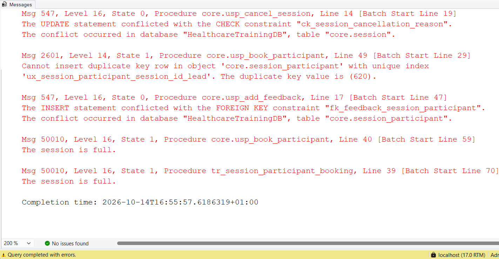
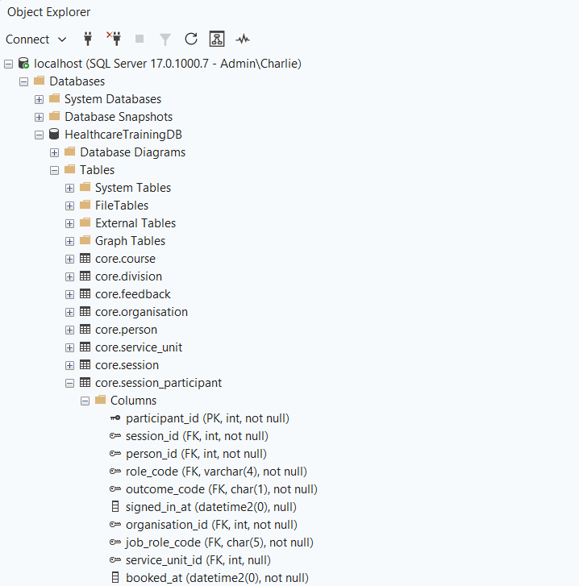
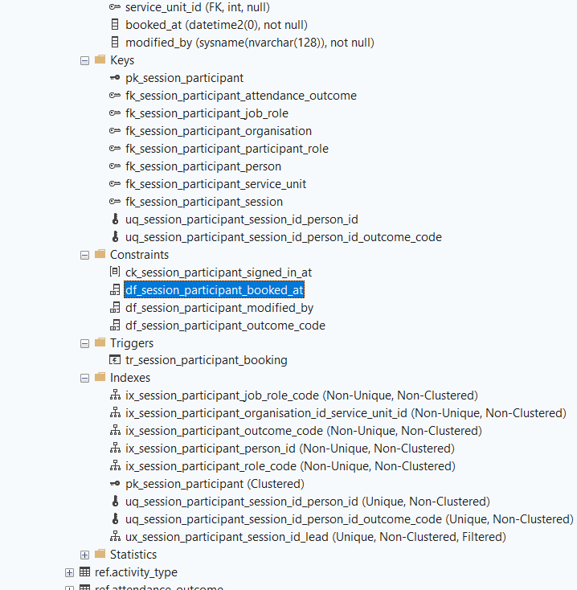
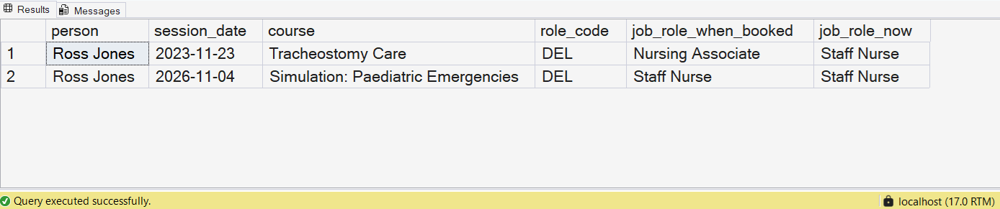
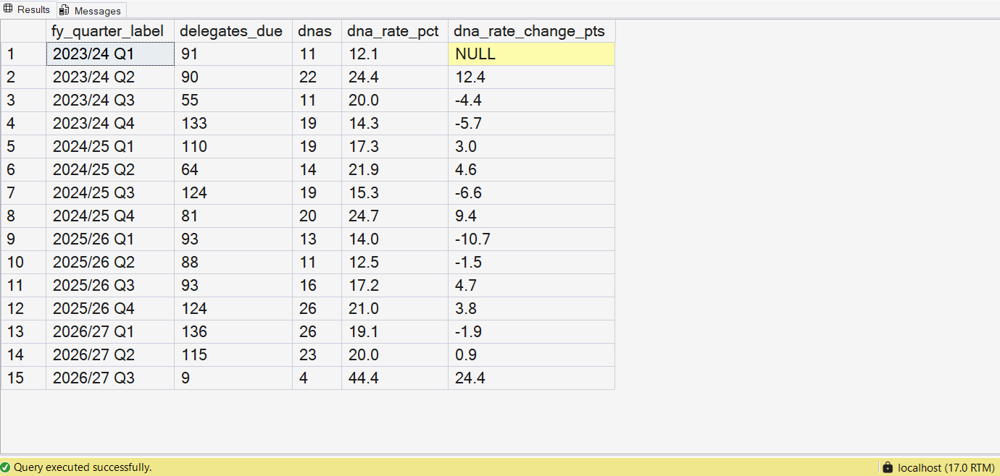
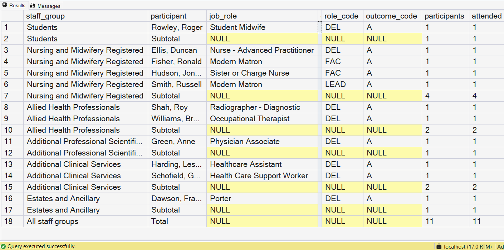
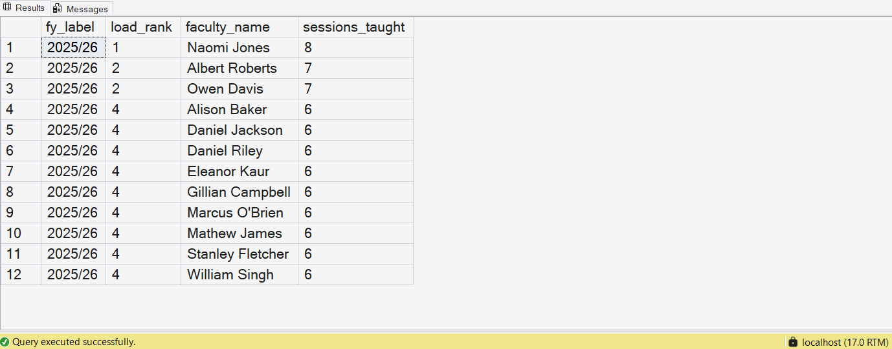

Clinical simulation training generates awkward data: courses, faculty, candidates, equipment, feedback and outcomes, all related and all changing. At OxSTaR, the University of Oxford's simulation centre at the John Radcliffe Hospital, delivery was largely for NHS staff, and reporting went to NHS stakeholders, where it was used to account for how training spend translated into activity. I designed, built and maintained the MS Access database behind that reporting.

This project revisits that database design, rebuilt from scratch in T-SQL on SQL Server. The rebuild demonstrates the data model and the reporting rather than reproducing the original system: a schema built around NHS Data Dictionary code lists, business rules enforced by the database itself rather than the forms in front of it, a write path of stored procedures, and reporting views for the questions a centre's leads ask. The trust, its people and all of the data are synthetic, and no code or data from the original system is used.

::: {.callout-note appearance="simple"}
**OxSTaR, University of Oxford**, John Radcliffe Hospital. The original system was published in BMJ STEL and awarded Best in Technology at ASPiH 2018.

SQL Server 2025 · T-SQL · SSMS · 16 business rules enforced by the database · 7 write procedures · 5 reporting views and 2 reporting procedures

[Paper (doi:10.1136/bmjstel-2019-000441)](https://doi.org/10.1136/bmjstel-2019-000441) · [Code](https://github.com/charles-mcd/healthcare-training-db) · [Design](https://github.com/charles-mcd/healthcare-training-db/blob/main/docs/design.md) · [Data dictionary](https://github.com/charles-mcd/healthcare-training-db/blob/main/docs/data-dictionary.md)
:::

```{mermaid}
flowchart LR
    SG[staff_group] --> JR[job_role]
    JR --> P[person]
    ORG[organisation] --> DIV[division] --> SU[service_unit]
    ORG --> P
    SU -.-> P
    C[course] --> S[session]
    P --> SP[session_participant]
    S --> SP
    SP --> F[feedback]
    SP --> R[rpt views<br/>and procedures]
```

Arrows run from parent to child table; the dotted arrow is optional, as partner staff have no unit.

The design document sets out every table, rule and report in full; this page covers the highlights.

## 1. From requirements to rules

> The centre's leads described what they needed in plain terms: know who attended and who didn't, never overbook a course, report staff in the role they held at the time, and use national codes so the numbers mean the same thing everywhere. Each requirement was translated into a rule and enforced at the lowest layer of the database able to hold it: column types and NOT NULL first, then keys, then CHECK constraints, with a trigger and stored procedures reserved for rules that depend on other rows or tables.

| The centre needs | Rule | Enforced by |
|---|---|---|
| job roles recorded in national terms | job roles use NHS Data Dictionary codes, each within its staff group | foreign keys to the code lists, and a CHECK on the code |
| cancellations explained | a cancelled session carries a reason | CHECK constraint |
| one person leading each session | one lead faculty per session | filtered unique index |
| feedback only from people who were there | feedback only from attendees | composite foreign key through a persisted computed column |
| no course overbooked | no booking over capacity or onto a cancelled session | stored procedure, with a trigger as backstop |
| staff reported in the role they held at the time | each booking keeps the role held when it was made | the booking procedure copies the role onto the booking |

Each layer rejects a bad row with an error that names what was broken. The script behind this screenshot tries to break five rules, one per layer, inside transactions that are rolled back:



**Rules summary:**

- 16 rules in all, listed in the [design](https://github.com/charles-mcd/healthcare-training-db/blob/main/docs/design.md#rules) with the error each one raises
- every constraint is named for what it enforces (`ck_`, `fk_`, `ux_` and so on), so an error message names the rule that was broken
- built-in error numbers (547, 2601, 2627) and custom ones (50001 to 50021) give a front end fixed codes to map to friendly messages
- rules that depend on another table, such as host-trust staff needing a service unit, sit in the procedures that write the data

## 2. Schema design

> Three schemas separate the code lists (`ref`), the operational tables (`core`) and the reporting layer (`rpt`). Staff groups and job roles use the national codes from the [NHS Data Model and Dictionary](https://www.datadictionary.nhs.uk/attributes/job_role_code.html), loaded with their source and retrieval date, so a staff group in a report means what it means nationally. Keys do more than identify rows: composite foreign keys keep related records inside the same organisation, and filtered unique indexes express rules that only apply to some rows.

The booking table uses both. The unit copied onto a booking must belong to the organisation copied with it, and only the lead's row must be unique per session:

```{.sql filename="206_core_session_participant.sql"}
CREATE TABLE core.session_participant
(
    -- ...
    CONSTRAINT fk_session_participant_service_unit FOREIGN KEY (organisation_id, service_unit_id)
        REFERENCES core.service_unit (organisation_id, service_unit_id)
        ON DELETE NO ACTION
);

CREATE UNIQUE NONCLUSTERED INDEX ux_session_participant_session_id_lead
    ON core.session_participant (session_id)
    WHERE role_code = 'LEAD';
```

::: {layout-ncol=2}



:::


**Schema summary:**

- 10 staff groups and the 34 job roles in use, from the NHS Data Dictionary; a CHECK ties each job role code to its staff group through its first two characters
- composite foreign keys stop a person or booking pointing at a unit in another organisation; the UNIQUE keys that look redundant are there as their targets
- filtered unique indexes handle conditional uniqueness: one host trust, one lead per session, and email unique only when it's given
- every foreign key is indexed on the child side, which SQL Server doesn't do automatically, and none cascade, so deleting a parent can't erase history

## 3. The write path

> Every write is designed to go through a stored procedure. Each runs in a transaction with XACT_ABORT ON and TRY/CATCH, so any error rolls back all of its work and reaches the caller with its original number. Booking is the most demanding case: two people booking the last place at the same moment must not both succeed, and the booking has to record the person's role as it stands that day.

The booking procedure locks the session row before counting places, so concurrent bookings for the same session wait their turn rather than race:

```{.sql filename="305_core_usp_book_participant.sql"}
SELECT @status_code = s.status_code,
       @capacity    = s.capacity
FROM core.session AS s WITH (UPDLOCK, HOLDLOCK)
WHERE s.session_id = @session_id;

IF @status_code = 'X'
    THROW 50011, N'The session is cancelled.', 1;

IF @role_code = 'DEL'
BEGIN
    SELECT @booked = COUNT(*)
    FROM core.session_participant AS sp
    WHERE sp.session_id = @session_id
      AND sp.role_code = 'DEL'
      AND sp.outcome_code <> 'X';

    IF @booked >= @capacity
        THROW 50010, N'The session is full.', 1;
END;
```

The same procedure copies the person's organisation, job role and unit onto the booking, so when someone is promoted, their earlier bookings keep the role they held at the time:



**Write path summary:**

- seven procedures cover every write: adding a person, changing their role, creating, cancelling and booking sessions, recording attendance and adding feedback
- `UPDLOCK, HOLDLOCK` on the session row makes bookings for the same session queue, so two can't both take the last place
- a trigger repeats the capacity check as a backstop for any write that bypasses the procedure
- copying the role at booking gives point-in-time reporting from a single table

## 4. Reporting

> The reporting layer gives analysts a stable set of views over the operational tables, with the definitions written into the views rather than left to each query: rates count delegates only, cancelled places are excluded, the DNA rate is did-not-attend over attended plus did-not-attend, and dates map to NHS financial years and quarters through a date table. Staff groups come from the booking, so a report on last year shows staff as they were last year.

DNA rates by staff group and financial quarter come from a CTE that does the counting and a window function that compares each quarter with the one before:

```{.sql filename="530_rpt_v_dna_by_staff_group.sql"}
SELECT
    fy_quarter_label,
    staff_group_code,
    staff_group,
    delegates_due,
    dnas,
    CAST(dna_rate AS decimal(5, 1)) AS dna_rate_pct,
    -- LAG reads the same staff group's previous quarter; it is empty for the first one.
    CAST(dna_rate - LAG(dna_rate) OVER (PARTITION BY staff_group_code ORDER BY fy_label, fy_quarter)
         AS decimal(5, 1)) AS dna_rate_change_pts
FROM quarterly;
```







**Reporting summary:**

- `rpt.v_participation` is the base view: one row per booking, with course, organisation, division and the staff group held at the time
- session fill and DNA rates, DNA trends by staff group and quarter, faculty load and the session register, built with CTEs, conditional aggregation, `NULLIF` against divide-by-zero, `LAG`, `RANK` and `GROUP BY ROLLUP`
- a name search matches the start of a name with `LIKE` and similar-sounding surnames with `SOUNDEX`
- `rpt.dim_date` maps every day from April 2022 to March 2027 to its NHS financial year and quarter

## 5. Build and documentation

> The database is built entirely from code. One command drops and recreates it from `master`, runs the SQL files in numbered order, loads the national code lists and the calendar, then generates the synthetic data, so anyone with SQL Server can rebuild the same database.

```{.text filename="python scripts/build.py"}
Running 000_database.sql
Running 010_schema_ref.sql
...
Running 570_core_usp_find_person.sql
Loading staff_group.csv
Loading job_role.csv
Loading the calendar
Synthetic data: 2200 people, 650 sessions, 5502 delegate rows, 1637 faculty rows, 2135 feedback
Build complete
```

**Build summary:**

- one object per file, numbered in build order, with every constraint named
- national code lists stored as CSV with their source and retrieval date; NHS England content is excluded from the code's MIT licence
- synthetic data from a fixed seed: 2,200 staff across seven organisations and 650 sessions of 40 courses, April 2023 to December 2026, inserted through the same constraints and trigger as any other write
- two patterns are seeded to exercise the reports: a higher DNA rate in staff group 03, and about 5% of staff changing role part-way through
- every table and column carries a description, from which `scripts/data_dictionary.py` generates the [data dictionary](https://github.com/charles-mcd/healthcare-training-db/blob/main/docs/data-dictionary.md)
- the [queries behind each screenshot](https://github.com/charles-mcd/healthcare-training-db/blob/main/docs/screenshot_queries.sql) are in the repo

**Next:** a Power BI report on the `rpt` views.
